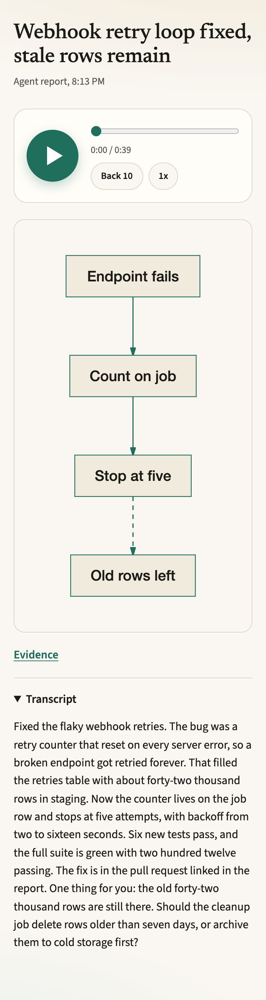

# earshot

Turn a coding agent's finished work into a voice memo and a one-glance diagram, and get back one chat line with two tappable words that start playing the moment you tap them: Listen for the edited memo and Original for your agent's own words.

<p align="center"></p>

## Why

- Reading a wall of agent text away from your desk is hard, and sometimes impossible.
- Read-aloud tools speak text that was written for the eye. A memo for the ear has a different shape: the outcome first, numbers spelled out, no file paths, one decision at the end.
- Nothing pairs a voice memo with a diagram you can take in at a glance.

earshot does that pairing for any agent that can hand it text.

## Quickstart

You need Node 22 or newer, pnpm, and a TTS server. [Kokoro-FastAPI](https://github.com/remsky/Kokoro-FastAPI) works with the defaults on port 8880. Any OpenAI-compatible `/v1/audio/speech` endpoint works too.

```bash
git clone https://github.com/maxpetrusenko/earshot.git
cd earshot
pnpm install
pnpm build
pnpm link --global      # puts `earshot` on your PATH

earshot init            # writes ~/.config/earshot/config.yaml
```

Or install from npm: `npm i -g @maxpetrusenko/earshot`, or run once with `npx @maxpetrusenko/earshot`.

A minimal `~/.config/earshot/config.yaml`:

```yaml
llm:
  type: claude-cli          # runs `claude -p` on your Claude login
  model: sonnet
  # or any OpenAI-compatible chat endpoint:
  # type: openai-compatible
  # base_url: http://localhost:11434/v1
  # model: qwen3:8b

tts:
  type: openai-compatible
  base_url: http://localhost:8880/v1
  model: kokoro
  voice: af_heart

serve:
  mode: loopback            # or tailscale-serve, see Privacy and security
```

Start the server in one terminal and make a memo from another:

```bash
earshot serve

echo "Fixed the flaky webhook retries. The counter reset on every 5xx, so a dead endpoint was retried forever. Now it stops after five attempts. 212 tests pass. Open question: delete the 41k stale rows or archive them?" | earshot run
# [Listen](http://localhost:7777/b/<id>/edited.mp3) · [Original](http://localhost:7777/b/<id>/original.mp3)
```

Tap either word (or open the URL). Audio starts while the memo is still being made: the original in about 1.5 seconds, the edited memo in about 4. Both links are one MP3 that keeps growing until the track is complete, then it becomes a normal seekable file. The card with the diagram and transcript is at `/b/<id>`; `--format plain` prints the old two lines (`Listen: <url>` and `Original: <url>`), and `--format json` prints `{listen, listen_original, card, id}`.

## Integrations

| Agent | Command | How the link reaches you |
|---|---|---|
| Claude Code, skill | `earshot install claude-code` | Claude ends its reply with one line: Listen · Original |
| Claude Code, hook | `earshot install claude-code --mode hook` | Stop hook message in the terminal UI |
| Orca chat (default in Orca) | `earshot run --format auto` | an inline Web Audio player on Orca desktop, plus the Listen · Original links for the phone, see [Orca](docs/orca.md) |
| Codex | `earshot install codex` | `notify` program, link in `~/.earshot/logs/hook.log` |
| Any MCP client | `earshot install mcp --client claude-code` | the agent calls the `narrate` tool and prints the one-line links |
| Anything else | `earshot run --from tagged` | reads the last `<narrate>...</narrate>` block from stdin |

Pick skill or hook mode per scope, not both. Details: [Claude Code](docs/claude-code.md), [Orca](docs/orca.md), [Codex](docs/codex.md), [MCP](docs/mcp.md). The installers back up the files they edit and never touch entries they did not write. `earshot uninstall <agent>` undoes them.

## How it works

```
 agent output
      |
 1. extract   Stop payload, Codex session log, <narrate> tag, or stdin
      |
 2. scrub     redact secret-shaped strings, cap input length
      |
      +--------------------------+--------------------+
      |                          |                    |
 original track             edited track          sketch (mermaid -> SVG)
 clean text -> TTS          LLM stream -> sentences    starts when the diagram
 sentence by sentence       -> TTS per chunk           is written, never blocks audio
      |                          |
 original.mp3 (growing)     edited.mp3 (growing)
      |                          |
      +------------+-------------+
                   |
 card + links   ~/.earshot/briefs/<id>/ served by `earshot serve`
                -> [Listen](<url>/edited.mp3) · [Original](<url>/original.mp3)
```

The original track has no LLM call: code, URLs and paths are dropped or spoken as short names, and each sentence goes to TTS at once. The edited track streams the script from the model; every sentence is leak-checked and has its digits spelled out locally (no retry call), then goes to TTS while the rest is still being written. A final check runs on the whole script; if it fails the edited track is marked failed and nothing from it is served.

The links are allocated before the work finishes. With `--detach`, and in every hook, the command prints the link at once and a background worker completes the memo, so the agent is never blocked.

## Privacy and security

- Text is scrubbed before any network call. API keys, tokens, private keys and `KEY=value` pairs are redacted, and long input is cut from the middle at `privacy.max_input_chars`.
- `claude-cli` removes `ANTHROPIC_API_KEY` from the child environment, so it uses your subscription login and never bills API credits.
- `earshot serve` binds loopback or a Tailscale address only. `tailscale-serve` mode never uses funnel. There is no public mode.
- A brief is reachable only by its 16-character id. The server serves the card, `edited.mp3`, `original.mp3`, the sketch and `meta.json` per brief (and `memo.mp3` for briefs made before the two tracks existed). The chunk files, `input.txt` and `script.md` are never served.
- The card HTML escapes every string. The SVG is sanitized and served with `script-src 'none'`. The card runs under a strict CSP with no inline scripts and no CDN calls.
- The evidence link on the card must appear in your text, point at an allowed host (`github.com`, `gitlab.com`, plus `privacy.evidence_hosts`) and carry no secret-looking path or query.
- MCP input is untrusted. It gets the same scrub, tags are stripped, and a server process accepts 6 `narrate` calls per 10 minutes.

Scrubbing is pattern based. It misses a secret that does not look like one, so keep the server on a network you trust.

## Script style and voices

`script.style` picks the prompt. `short` (the default) is a 20 to 40 second summary, hard capped at 110 words in code: what got done, what changed for you, then one decision as a question. It leaves out quoted text, file names, paths, number lists and URLs and points to the chat instead. `story` is the longer conversational memo that reads quoted text such as a post draft word for word. `brief` is the terse status memo. The Original track is the reply read as written, with code blocks, link targets, URLs, flags and paths skipped, and a table replaced by one line saying it is in the chat.

`tts.profile` picks an entry of `tts.profiles`. `fast` is Kokoro. Any OpenAI-compatible `/v1/audio/speech` server can be a profile, for example a voice clone; if a server answers with WAV, earshot converts it with ffmpeg. A clone that takes tens of seconds per sentence cannot stream, so keep the fast profile as the default unless it keeps up.

`llm.model: sonnet` is the default for `claude-cli`. In testing it streamed its first words in about 1.5 seconds; haiku spent 6 to 10 seconds thinking before the first word.

## Config reference

Every key, with defaults and comments, is in [`config.example.yaml`](config.example.yaml). Unknown keys are an error. Keys never hold secrets, only the name of the environment variable to read.

## Demo video

The demo in [`video/`](video/README.md) is built with [HyperFrames](https://github.com/heygen-com/hyperframes) from the real card markup and a real Kokoro memo.

## Roadmap

- Phone checks: lock-screen controls and seeking on iOS and Android, HTTPS versus plain HTTP.
- Voice input: answer the decision at the end of a memo by voice.
- More publishers: S3, R2 and a custom command, next to `earshot serve`.

## License

MIT. See [LICENSE](LICENSE).
